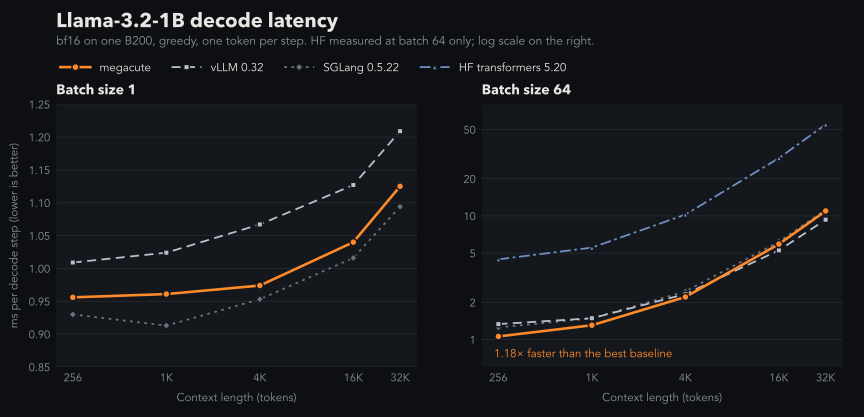

# megacute

Persistent megakernels for transformer graphs, written entirely in CuTe DSL (Python), host to
device. You describe a model as a graph of ops in Python. megacute tiles it into instructions
with fine-grained cross-SM dependencies and runs the whole graph -- every layer, attention, norms,
the lm_head -- as **one persistent kernel launch** on Blackwell (sm_100a).

The core package knows nothing about specific models. Models live in `examples/` as graph
builders on top of the public API.

```python
import torch, megacute as mc

g = mc.Graph()
x  = g.input("x", (4096, 2048))
nw = g.param("nw", (1, 2048))
w1 = g.param("w1", (11264, 2048))          # gate|up, interleaved by mc.swiglu_weight
w2 = g.param("w2", (2048, 5632))
h  = g.linear(g.rms_norm(x, nw), w1, act="swiglu")       # (4096, 5632)
g.output(g.linear(h, w2, residual=x))

prog = mc.compile(g)                         # schedule + one cute.compile
y = prog(x=x_t, nw=nw_t, w1=mc.swiglu_weight(wg_t, wu_t), w2=w2_t)   # one kernel launch
```

## Performance



Llama-3.2-1B decode with `examples/llama`, bf16, one B200. The baselines are vLLM 0.32,
SGLang 0.5.22 and Hugging Face transformers 5.20 (default settings: SDPA attention, dynamic cache).
At batch 1, megacute is faster than vLLM at every context length and within 5% of SGLang.

Batch 64, ms per decode step (lower is better):

| context | megacute | vLLM | SGLang | HF transformers |
|---|---|---|---|---|
| 256 | **1.06** | 1.33 | 1.25 | 4.45 |
| 1K | **1.31** | 1.49 | 1.48 | 5.54 |
| 4K | **2.21** | 2.33 | 2.45 | 10.26 |
| 16K | 5.92 | **5.27** | 6.19 | 29.34 |
| 32K | 10.97 | **9.32** | 11.23 | 54.89 |

At batch 64, megacute is the fastest up to 4K context, and 4-5x faster than HF transformers at
every length. Past 16K, batch-64 attention runs as only 128 instructions across 148 SMs, so vLLM
pulls ahead. Splitting the KV sequence by context length is the open fix.

## Install

```bash
pip install -e .            # torch >= 2.10, nvidia-cutlass-dsl 4.8.0, apache-tvm-ffi, torch-c-dlpack-ext
pip install -e .[llama]     # + transformers, safetensors, huggingface_hub for examples/llama
python examples/llama/llama1b.py --check     # Llama-3.2-1B: generate, report tok/s, compare with transformers
```

Requires a Blackwell (sm_100a) GPU. torch and nvidia-cutlass-dsl must agree on the CUDA major.

## Layout

```
megacute/
  graph.py      graph IR: buffers, views, ops, and the Graph builder API
  schedule.py   tiles ops into instructions; dependency counters; instruction encoding
  runtime.py    Program: graph passes, layer merging, compile, binding, launch
  layers.py     merges the same op of every layer into one kernel node
  kernel.py     the persistent kernel: warp roles, page pool, barriers, dispatch
  ops/          device code per op: gemm, attention (prefill), decode, norm, eltwise, splitk
  trace.py      in-kernel per-SM timeline (prog.timeline())
  dmath.py      fp32 device math (ex2, rcp, rsqrt, activations)
  config.py     CTA shape, warp roles, smem pool, tile sizes
examples/
  llama/        model.py: Llama prefill / decode builders; llama1b.py: Hugging Face checkpoint runner
  dit/          model.py: DiT (adaLN-Zero) builders
```

## The graph

**Buffers and views.** Every tensor is a 2-D row-major buffer `(rows, cols)`. Higher-rank
activations are flattened to `(batch * seq, features)`; attention heads are column ranges. Ops read
and write *views* -- rectangular windows (`cols_slice`, `rows_slice`) -- so slicing a fused QKV
output into q, k, v costs nothing, and every dependency is an intersection of rectangles.

| buffer kind | made by | meaning |
|---|---|---|
| input | `g.input(name, shape)` | caller-provided, read-only |
| param | `g.param(name, shape)` | weights, read-only |
| state | `g.state(name, shape, dtype)` | caller-owned, updated in place by the launch (KV caches, decode position, decode hidden state) |
| temp / output | returned by ops, `g.output(view)` | allocated by the runtime |

**Ops** (methods of `Graph`; each returns its output view):

| op | notes |
|---|---|
| `linear(x, w, bias=, act=, residual=)` | `act(x @ w.T + bias) + residual`; act in relu, silu, gelu(_tanh), or `"swiglu"` (w interleaves gate/up in 64-row blocks, see `swiglu_weight`) |
| `attention(q, k, v, batch=, heads=, head_dim=, causal=, kv_heads=)` | prefill: flash-style online softmax on tcgen05, GQA/MQA, cross-attention; head_dim 64/128 |
| `rope(x, cos, sin, heads=, head_dim=, seq=)` | rotate-half RoPE |
| `rms_norm`, `layer_norm` | optional affine |
| `unary`, `binary` / `add` / `mul`, `swiglu`, `modulate` | pointwise; per-group broadcast of b (e.g. per-batch conditioning) |
| `rope_append(qkv, cos, sin, pos, k_cache, v_cache, ...)` | decode: rotate q, k of one new token per sequence at the on-device position `pos`, append k, v to the caches |
| `decode_attention(q, k_cache, v_cache, pos, ...)` | decode: one query token per sequence against its cache, GQA |
| `increment(pos)` | `pos += 1` after every reader of `pos` in the launch |

## How it works

**Host** (`mc.compile(g)` -> `runtime.Program`):

1. Graph passes, each a rewrite on a copy of the graph:
   - `fold_norms`: for few rows (decode), an RMSNorm that only feeds GEMMs moves into them -- its
     gain into a derived weight `W * diag(g)` (computed at bind time), its rstd into the GEMM
     epilogue.
   - `split_k`: a GEMM that cannot fill the GPU is split along K (count chosen by a cost model).
     Partials of a residual linear reduce-add straight into the residual stream; others go to an
     fp32 workspace and a finalize op, which a following RoPE can absorb.
   - `fuse_rope_attention`: a `rope_append` that only feeds `decode_attention` becomes part of it.
   - `split_kv`: decode attention for few sequences splits each sequence's keys over more SMs
     (the last split to finish combines); for many sequences it groups 4 kv heads per
     instruction.
2. `layers.merge_layers`: the same op in every layer becomes one kernel node; each instruction
   carries its layer index and per-layer buffers are stacked.
3. `schedule`: every op is tiled into instructions; dependencies come from overlapping
   read/write rectangles (RAW, WAR, WAW; split-K partials commute) and become counters, with
   waits implied by other waits pruned.
4. One `cute.compile` against fake tensors with `--enable-tvm-ffi`; later calls bind real tensors
   and launch. Counters use launch epochs, so nothing is cleared between launches.

**Device** (`kernel.py`): one CTA per SM, 8 warps.

| warp(s) | role |
|---|---|
| 6 | controller: fetches this CTA's instructions (static round robin over the global order) into a smem ring |
| 5 | loader: waits on dependency counters, allocates pages, issues TMA loads |
| 4 | MMA: tcgen05 into TMEM |
| 0-3 | compute: epilogues, softmax, norms, pointwise, decode attention |
| 7 | storer: TMA-stores staged output tiles, then publishes the instruction's counters |

- **Page pool:** 6 x 32 KB smem pages shared by every op. The loader is the only allocator; it
  hands each page to its consumer role through a FIFO of (page, parity) records, so no role ever
  guesses a barrier phase.
- **Overlap:** a GEMM's weight tiles load before its dependencies are met; an instruction's
  epilogue overlaps the next one's main loop; the storer frees the staging buffer as soon as TMA
  has read it.
- Each op class in `ops/` implements the four roles -- `load`, `mma`, `compute`, `store` -- and
  the kernel dispatches on the instruction's node index.

## Adding a new model

A model is a function that returns a `Graph`. Put it in `examples/<model>/model.py`, next to a
runner that loads weights and calls it.

**1. Write the builder.** Declare inputs, parameters and state; emit ops per layer.

```python
import torch
import megacute as mc

PARAMS = lambda E, F, QKV: [("attn_norm", (1, E)), ("wqkv", (QKV, E)), ("bqkv", (1, QKV)),
                            ("wo", (E, E)), ("mlp_norm", (1, E)), ("wgu", (2 * F, E)), ("wd", (E, F))]

def decoder_decode(B, E, H, KVH, F, n, max_seq, vocab, eps=1e-6):
    D, QKV = E // H, (H + 2 * KVH) * (E // H)
    g = mc.Graph()
    x = g.state("x", (B, E))                                   # embedded tokens in, residual stream after
    cos, sin = g.input("cos", (max_seq, D)), g.input("sin", (max_seq, D))
    pos = g.state("pos", (1, 1), torch.int32)
    kc = g.state("k_cache", (n * B * max_seq, KVH * D))        # layer i at rows [i*B*max_seq, ...)
    vc = g.state("v_cache", (n * B * max_seq, KVH * D))
    ps = {k: g.param(k, (n * r, c)) for k, (r, c) in PARAMS(E, F, QKV)}   # stacked over layers
    for i in range(n):
        g.layer = i                                            # tag ops so layers merge
        p = {k: ps[k].rows_slice(i * r, r) for k, (r, _) in PARAMS(E, F, QKV)}
        kci, vci = kc.rows_slice(i * B * max_seq, B * max_seq), vc.rows_slice(i * B * max_seq, B * max_seq)
        qkv = g.linear(g.rms_norm(x, p["attn_norm"], eps), p["wqkv"], bias=p["bqkv"])
        q = g.rope_append(qkv, cos, sin, pos, kci, vci, heads=H, kv_heads=KVH, head_dim=D, max_seq=max_seq)
        a = g.decode_attention(q, kci, vci, pos, heads=H, kv_heads=KVH, head_dim=D, max_seq=max_seq)
        x = g.linear(a, p["wo"], residual=x)
        x = g.linear(g.linear(g.rms_norm(x, p["mlp_norm"], eps), p["wgu"], act="swiglu"), p["wd"], residual=x)
    g.layer = None
    g.increment(pos)
    g.output(g.linear(g.rms_norm(x, g.param("final_norm", (1, E)), eps), g.param("lm_head", (vocab, E))))
    return g
```

Rules that keep it fast and correct:
- **Stack parameters over layers** -- one `(n * R, C)` param, sliced per layer with
  `rows_slice` -- and set `g.layer = i` while emitting layer `i`. That is what lets
  `merge_layers` turn n copies of each op into one kernel node; without it every layer becomes
  separate nodes (slow to compile, large kernel).
- **Fuse at the graph level where the op supports it:** one QKV linear sliced with `cols_slice`,
  gate|up as one `act="swiglu"` linear, `residual=` on the linear rather than a separate add.
- **Prefill vs decode:** prefill graphs use `attention` + `rope` over `(batch * seq, E)`
  activations (see `examples/llama/model.py: llama_stack`). Decode graphs keep the hidden state,
  caches and `pos` as `state`, use `rope_append` + `decode_attention` and end with
  `increment(pos)`, so one compiled program serves every step and every context length.
- Shapes are static per compile (batch, max_seq); `pos` is the only dynamic length.

**2. Convert the weights** to the builder's parameter layout: concatenate q/k/v rows into
`wqkv`, interleave gate and up with `mc.swiglu_weight(gate, up)`, and stack layers along rows
(`examples/llama/llama1b.py: params` does this for Hugging Face Llama checkpoints, including
Llama-3 RoPE scaling and tied embeddings).

**3. Run and verify.** `prog = mc.compile(builder(...))`, then `prog(**inputs, **params, **state)`
once per step. Compare with a reference implementation -- e.g. greedy tokens against
`transformers`, as `llama1b.py --check` does.

**If the model needs an op megacute lacks** (e.g. QK-norm, a different activation):
1. `graph.py`: an `Op` dataclass declaring its `reads` / `writes` views, plus a `Graph` method.
2. `schedule.py: tile_op`: how it splits into instructions and which rectangles each one reads
   and writes -- this is all the scheduler needs for dependencies.
3. `ops/<name>.py`: a `Node` subclass implementing the roles it uses (`load` for TMA, `mma`,
   `compute`, `store`); `runtime._node_for` maps the op to it.
4. `layers._unit`: the row granularity of each operand, if layers should merge.

## Debugging

- `mc.compile(g, debug=True)` (or `MEGACUTE_DEBUG=1`): a watchdog in every barrier wait and
  dependency spin; a stuck wait prints CTA, warp, barrier, phase and instruction instead of
  hanging silently.
- `mc.compile(g, trace=True)`: per-SM, per-role timestamps for every instruction;
  `prog.timeline().summary()` gives per-node span, dependency wait and busy time, and
  `.save_chrome(path)` writes a Perfetto / chrome://tracing trace.
- `MEGACUTE_NO_MERGE=1` disables layer merging.

## Limitations

- bf16 activations and weights; head_dim 64 or 128; GQA groups up to 8 in decode.
- Blackwell sm_100a only (tcgen05 / TMEM).
- Decode: all sequences of a batch share one position (synchronous batch); contiguous
  per-sequence KV cache (zero-initialised; max_seq a multiple of 128).
- No MoE, sliding-window attention or paged KV cache yet. Forward only.

## Acknowledgements

megacute is a CuTe DSL take on ideas from [HazyResearch](https://github.com/HazyResearch):

- [MegaKittens](https://github.com/HazyResearch/Megakernels): the megakernel design that megacute
  follows. That covers instruction-level scheduling of a whole operator graph into one persistent
  kernel, the controller / loader / compute / storer warp roles over a shared page pool, and
  global-memory counters for cross-SM dependencies. Its Llama decode work shaped megacute's decode path.
- [ThunderKittens](https://github.com/HazyResearch/ThunderKittens): the tile-based kernel
  abstractions MegaKittens is built on.

Thanks to the HazyResearch team for open-sourcing both.
